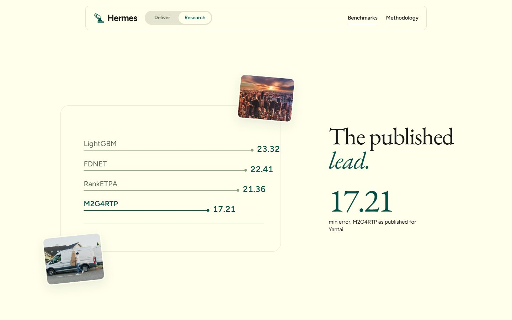
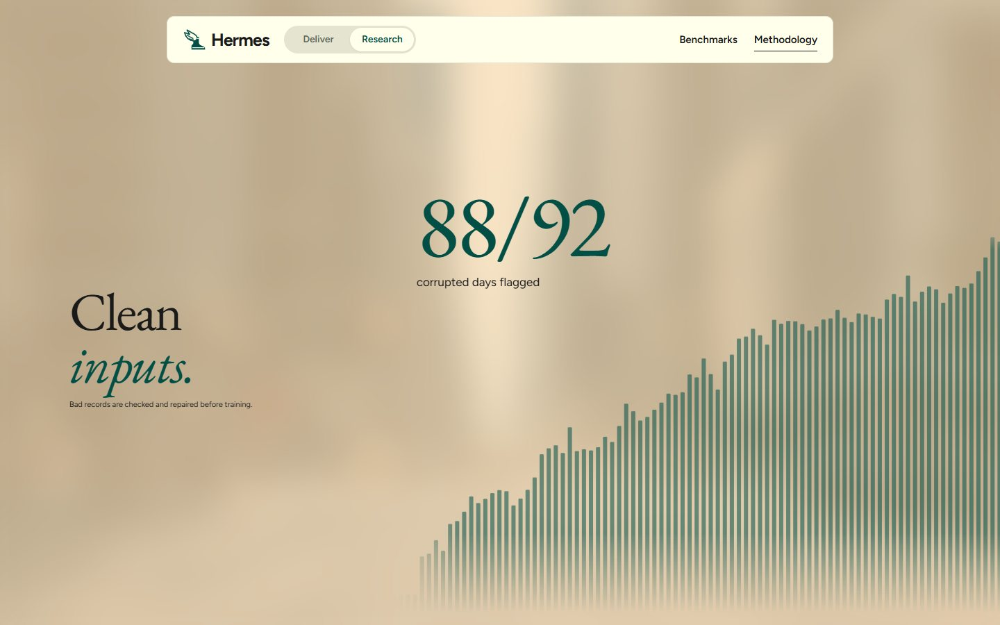

<p align="center">
  
</p>

<h1 align="center">Hermes</h1>

<p align="center">
  Live delivery ETAs that predict the courier's route first, then the time, and stay reliable when the data goes bad.
  <br />
  <a href="https://tryhermes.org"><strong>tryhermes.org</strong></a>
</p>

<p align="center">
  
</p>

## Overview

Hermes predicts how many minutes remain until each pending package is delivered, and updates every prediction after
each courier delivery. It is built on **LaDe-D**, a public dataset of real courier logs from Cainiao, and answers the
W&M AI Case-a-thon question: *how do stale and low-quality data change an AI system's predictions, and can a fix
restore them?*

| Benchmarks | Methodology | Data quality |
|:---:|:---:|:---:|
|  |  |  |
| What the published state of the art really scores | Stop order first, then time | Bad records caught before they reach the model |

## Results

All results are for Yantai, trained on May to August and tested on September 16 to 30. No prediction uses information
recorded after its own moment.

### 1. Live ETA model

| Measure | Result |
|---|---:|
| Average error | **55.9 min** |
| Typical (median) error | **27.0 min** |
| Packages due within 30 min / 30 to 60 min / 1 to 3 h | 28.9 / 30.5 / 34.1 min |
| Packages due in 3 to 24 h | 105.2 min |
| Predictions within 30 min of the truth | 53.5% |
| Next stop predicted first / true next 3 stops in the top 3 | 49.1% / 70.8% |

155,296 live predictions on 14,234 packages. Source: [`evidence/model`](evidence/model/results/metrics.json).

### 2. The published benchmark relies on leaks

We ran the LaDe authors' own code (it needed 7 fixes to run at all) and found six ways its setup uses information from
the future or scores generously, for example showing the model only packages that *will* be delivered within 2 hours.
`check.py` points to each leak by file and line.

| Their best model (M2G4RTP), Yantai | Average error |
|---|---:|
| Reported in the paper | 17.2 min |
| Our rerun of their code, their scoring | 12.5 min |
| Same model, scored per package | 22.2 min |
| Three leaks removed, scored per package | 23.3 min |

Source: [`evidence/leaks`](evidence/leaks).

### 3. Bad data, with and without the safeguards

A simulated low-quality scanner app (bulk-synced timestamps, GPS jitter, re-sent records) spreads to 60% of couriers,
and delayed uploads hit 60% of couriers during the test window. Measured with the previous model version (58.5 min on
clean data).

| Condition | No fix | With safeguards | Damage recovered |
|---|---:|---:|---:|
| Clean data | 58.5 | 58.5 | no cost |
| Stale feeds | 63.3 | 60.0 | 68% |
| Low-quality feeds | 80.1 | 66.7 | 62% |
| Both | 84.0 | 66.9 | 67% |

- **Data contract:** 88 of 92 bad-feed days flagged, 0 of 92 clean days.
- **Cleaning:** 100% of re-sent records removed with no real package lost; 97% of bulk-synced records quarantined
  versus 0.03% of good ones.
- **Limit:** a fault the detectors were not designed for (random timestamp errors) is only partly handled
  (69.7 to 62.7 min).

Source: [`evidence/baddata`](evidence/baddata/results/REPORT.md).

## How it works

1. **Route order, in two levels.** A model picks the courier's next zone (a group of nearby buildings), then a
   second model orders every pending package, using the courier's real GPS position, depot, habits, and movement
   patterns.
2. **Time.** Three averaged LightGBM models turn that order, live area conditions and the courier's recent pace into
   minutes remaining; a specialist takes over for packages likely to slip to a later day.
3. **Safeguards.** Records are de-duplicated and repaired before use, late uploads switch to a staleness-aware model,
   a risk model marks the 10% least certain ETAs, and a daily data contract and drift check watch the inputs.

## Repository

| Path | Contents |
|---|---|
| [`server/`](server) | Data, features, models, training, safeguards, FastAPI service, tests |
| [`evidence/`](evidence) | One folder per claim: `model`, `leaks`, `baddata`, each with code to reproduce it |
| [`research.md`](research.md) | Plain-language findings and limits |
| [`app/`](app) | React + TypeScript frontend (Bun), served by the API at tryhermes.org |

## Quick start

Requires Python 3.10+, [uv](https://docs.astral.sh/uv/) and [Bun](https://bun.sh) 1.4.2.

```sh
uv sync
uv run python -m server.cli download --city yt     # pinned, checksum-verified data
uv run python -m server.cli train --city yt        # about 20 min on 16 threads
(cd app && bun install --frozen-lockfile && bun run build)
uv run uvicorn server.api.app:create_app --factory # site and API on http://localhost:8000 (API under /api, docs at /docs)
```

Develop the frontend with live reload (`/api` is proxied to the server on port 8000):

```sh
cd app && bun run dev                              # http://localhost:5173
```

Checks (the same as CI):

```sh
uv run ruff check server evidence && uv run python -m unittest discover -s server/tests -t .
cd app && bun run lint && bun run typecheck && bun test tests
```

Reproduce the evidence:

```sh
uv run python -m evidence.leaks.setup && uv run python -m evidence.leaks.check
uv run python -m evidence.baddata.run && uv run python -m evidence.baddata.report    # about 2.5 h
```

## Limits

- One city and one test window. September was examined during development; October is untouched.
- "Delivered" is when the courier recorded it, not a customer confirmation, and timestamps appear processed.
- The largest remaining gap is stop order: with the true order known, error would fall by about 40%.

## Data

[LaDe](https://huggingface.co/datasets/Cainiao-AI/LaDe) by Cainiao (Wu et al., arXiv:2306.10675), used with the
case owners' confirmation. Attribution and non-commercial use apply. The data is not stored in this repository.
